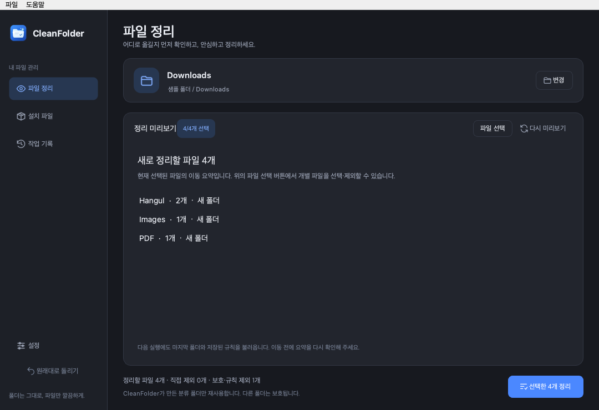
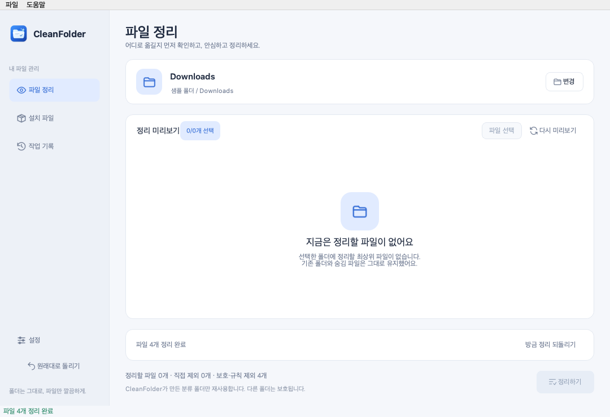

<p align="center">
  
</p>

<h1 align="center">CleanFolder</h1>

<p align="center">
  <strong>정리 전에 확인하고, 필요하면 원래대로.</strong><br>
  저장한 기준으로 반복 정리하고, 결과를 바로 되돌리는 macOS 파일 정리 앱
</p>

<p align="center">
  <a href="https://github.com/onechamp965/CleanFolder/releases/latest"></a>
  
  
  <a href="docs/mcp.md"></a>
</p>

<p align="center">
  <a href="https://github.com/onechamp965/CleanFolder/releases/latest"><strong>macOS 앱 다운로드</strong></a>
  · <a href="#사용법">사용법</a>
  · <a href="docs/mcp.md">MCP 연결</a>
  · <a href="docs/architecture.md">구조와 설계</a>
  · <a href="CHANGELOG.md">변경 이력</a>
</p>

---

## 프로젝트 소개

CleanFolder는 다운로드 폴더나 작업 폴더에 모인 파일을 **저장한 규칙으로 반복 정리하는 로컬 데스크톱 앱**입니다. 앱을 열어 이동 요약을 확인하고 정리한 뒤, 결과 화면에서 바로 되돌릴 수 있습니다. AI 모델·로그인·API 키 없이 기본 기능을 사용합니다.

이 문서는 **공개 버전 v1.6.0**을 기준으로 합니다. Apple Silicon용 DMG·앱 ZIP과 체크섬을 [GitHub Releases](https://github.com/onechamp965/CleanFolder/releases/tag/v1.6.0)에서 제공합니다. [v1.6.0 변경 안내](docs/releases/v1.6.0.md)

설계의 중심은 **Preview-first · 기록 기반 복구 · 공통 Core**입니다. 파일 이동 전에 대상과 위치를 확인하고, 이동 전후 상태를 작업 기록에 저장하며, GUI와 MCP가 동일한 처리 규칙을 사용하도록 구성했습니다.

| 항목 | 현재 상태 |
| --- | --- |
| 배포 버전 | [v1.6.0](https://github.com/onechamp965/CleanFolder/releases/tag/v1.6.0) |
| 배포 환경 | Apple Silicon · macOS 14 이상 · DMG / 앱 ZIP |
| 개발 환경 | Python 3.10+ · PySide6-Essentials · Send2Trash |
| MCP 제공 방식 | 선택 설치 Python 서버 · stdio · 도구 4개 |
| 분류 방식 | 파일 이름의 확장자와 사용자 지정 규칙 |
| 기록 저장 | 로컬 JSON · GUI와 MCP 공통 사용 |

## 대상 사용자

| 사용자 | 사용 상황 | 제공 가치 |
| --- | --- | --- |
| 주 대상: 반복 정리가 필요한 Mac 사용자 | 다운로드 폴더에 문서·이미지가 자주 쌓임 | 이전 폴더·규칙을 다시 사용해 요약 확인 후 정리 |
| 학생·사무직·문서 작업자 | 한글·Office·PDF 자료를 종류별로 관리 | `.hwp`·`.hwpx`를 포함한 문서 분류와 제외 규칙 |
| 개발자·MCP 사용자 | AI 클라이언트에서 로컬 파일 정리 기능을 호출 | 허용 경로와 승인 흐름을 갖춘 공통 Core 접근 |

사용자가 정리할 폴더와 실행 시점을 직접 결정하는 작업을 대상으로 합니다. 하위 폴더를 재귀적으로 정리하거나 파일 내용을 분석하는 기능, 중복 파일 제거, 상시 폴더 감시, 클라우드 동기화는 현재 제공하지 않습니다.

## 화면 미리보기


샘플 데이터로 실행한 v1.6.0 실제 앱 화면입니다. 간편 요약에서 실제 이동 폴더와 파일 수를 확인하고, **파일 선택**을 눌러 개별 파일을 선택합니다. 목록의 행·체크박스 또는 Space 키로 선택·제외할 수 있습니다. 폴더 분류 체계는 기존 13개를 유지합니다.

<details>
<summary>어두운 화면 보기</summary>



</details>

<details>
<summary>정리 완료와 즉시 복구 화면 보기</summary>



</details>

## 주요 기능

| 기능 | 동작 |
| --- | --- |
| 간편 요약과 상세 보기 | 폴더별 이동 요약을 기본으로 확인하고 필요할 때 파일별 선택 |
| 반복 정리 | 마지막 폴더·저장된 규칙·앱 생성 분류 폴더 재사용 |
| 파일 종류별 분류 | 한글(`.hwp`·`.hwpx`)·Word·Excel·PDF·이미지 등 분류 |
| 즉시 되돌리기 | 완료 화면에서 방금 정리한 작업만 복구, 이름 충돌 시 새 이름 사용 |
| 설정 | 분류 규칙·폴더 이름·제외 항목·시작 폴더·밝은/어두운 화면 |
| 설치 파일 관리 | GUI에서 직접 선택한 설치 파일만 운영체제 휴지통으로 이동 |
| MCP 연결 | 허용된 폴더의 조회·미리보기·정리·복구를 같은 Core로 제공 |

기본 분류는 `Word`, `Hangul`, `PowerPoint`, `Excel`, `PDF`, `Images`, `Videos`, `Audio`, `Archives`, `Installers`, `Code`, `Text`, `Others`입니다. 한글 문서의 기본 이동 폴더는 `Hangul`이며, 기존에 저장한 사용자 지정 확장자 분류는 유지합니다.

## 설치

**공개 설치본: 1.6.0 · Apple Silicon · macOS 14 이상**

1. [최신 릴리즈](https://github.com/onechamp965/CleanFolder/releases/latest)에서 **DMG**를 다운로드합니다.
2. DMG를 열어 `CleanFolder.app`을 `Applications`로 옮깁니다.
3. 응용 프로그램 폴더에서 실행합니다. Python을 별도로 설치할 필요는 없습니다.

**DMG와 앱 ZIP 중 하나만 받으면 됩니다.** `Source code (zip)`은 개발용 소스입니다. 서명·공증되지 않은 빌드는 macOS에서 실행이 차단될 수 있습니다. Windows 설치본은 아직 검증하지 않았습니다.

기존 사용자는 앱을 종료한 뒤 새 `CleanFolder.app`으로 교체하세요. 기존 앱은 자동 업데이트되지 않으며 저장한 설정·작업 기록은 유지됩니다.

## 사용법

v1.6.0을 처음 사용할 때:

1. **폴더 선택**으로 정리할 폴더를 고릅니다.
2. **간편 요약**에서 실제 이동 폴더와 파일 수를 확인합니다. 일부 파일을 남기려면 **파일 선택**을 누르고 해당 행이나 체크박스를 눌러 체크를 해제합니다.
3. **선택한 N개 정리**를 누릅니다.
4. 되돌리려면 완료 화면의 **방금 정리 되돌리기**를 누릅니다. 기존 사이드바의 **원래대로 돌리기**도 유지됩니다.

새 설치의 다음 실행에서는 마지막 폴더를 열고 미리보기만 표시합니다. 저장된 규칙과 확인된 앱 생성 폴더를 재사용하며, 파일은 정리 버튼을 누르기 전까지 이동하지 않습니다.

**이전 버전의 설정은 유지됩니다.** 기존 사용자는 미리보기의 **간편 보기**로 전환한 뒤 **이 폴더로 계속 정리**를 선택하거나, 설정에서 표시 방식·폴더 재사용·시작 폴더를 직접 선택할 수 있습니다.

설치 파일은 **설치 파일** 탭에서 선택해 휴지통으로 보냅니다. 휴지통으로 보낸 파일은 운영체제 휴지통에서 복원합니다. 분류·제외 규칙은 **설정**에서 변경합니다.

선택한 폴더 **바로 아래의 일반 파일만** 정리하며 기존 파일을 덮어쓰지 않습니다. 기존 폴더·앱 번들·숨김 파일·심볼릭 링크는 제외합니다. [상세 동작과 제한 사항](docs/development.md#파일-처리-기준)

## 작동 방식

```text
처음 폴더 선택 / 다음 실행 시 마지막 폴더 불러오기
  → 최상위 일반 파일 검사
  → 확장자 분류 · 제외 규칙 적용
  → 이동 요약 확인 · 필요 시 상세 선택
  → 실행 직전 파일·폴더·설정 상태 확인
  → 기록 저장 · 파일 이동 · 결과 표시
  → 완료 화면에서 해당 작업의 파일 위치 복구
```

예를 들어 아래 폴더를 기본 설정으로 정리하면 다음과 같이 이동합니다.

| 정리 전 | 정리 후 |
| --- | --- |
| `Downloads/회의록.hwp` | `Downloads/Hangul/회의록.hwp` |
| `Downloads/기획서.hwpx` | `Downloads/Hangul/기획서.hwpx` |
| `Downloads/참고자료.pdf` | `Downloads/PDF/참고자료.pdf` |
| `Downloads/사진.jpg` | `Downloads/Images/사진.jpg` |
| `Downloads/기존폴더/자료.pdf` | 기존 위치 유지 |

사용자가 만든 같은 이름의 폴더가 있으면 `Images (1)`처럼 새 폴더를 만듭니다. 새 설치의 GUI는 기록과 식별 정보로 확인된 앱 생성 폴더만 재사용합니다. 기존 사용자의 새 폴더 생성 설정은 유지되며, MCP 정리는 항상 새 폴더를 만듭니다.

**원래대로 돌리기는 파일 위치를 복구하는 기능**입니다. 파일 내용의 과거 버전을 보관하는 백업 기능은 아닙니다. 작업 도중 일부 항목이 실패하면 완료 수와 문제를 보고하며, 작업 기록을 바탕으로 복구를 시도할 수 있습니다. 미리보기 후 변경된 파일·폴더·분류 설정은 실행 전에 다시 확인합니다.

## MCP 지원

GUI와 MCP 서버가 같은 Core의 파일 처리·작업 기록·복구 기능을 사용합니다. 허용된 폴더에서 **조회 → 미리보기 → 사용자 승인 → 정리** 순서로 동작합니다.

도구: `scan_folder` · `preview_organization` · `organize_files` · `undo_last_operation`

MCP는 소스로 별도 실행하며 삭제·휴지통 이동 도구는 제공하지 않습니다. 실제 사용자 승인 UI는 클라이언트에서 제공합니다. [MCP 설치·설정·Inspector 안내 →](docs/mcp.md)

| 항목 | GUI | MCP |
| --- | --- | --- |
| 조작 방식 | 창·버튼·체크박스 | 클라이언트의 도구 호출 |
| 정리 대상 선택 | 미리보기 체크박스 | `include_names`의 정확한 파일 이름 |
| 실행 확인 | 사용자가 정리 버튼 선택 | 저장된 `preview_id`와 `approved: true` |
| 경로 접근 | 사용자가 선택한 폴더 | 서버 시작 시 `--allow`로 등록한 폴더 |
| 설치 파일 휴지통 이동 | 사용자 선택 후 가능 | 제공하지 않음 |
| 작업 기록·복구 | 공통 Core / History | 공통 Core / History |

MCP 미리보기는 5분 유효하며 승인된 실행을 시도하면 소모됩니다. `approved`는 클라이언트의 승인 선언이며 서버가 사람의 동의를 독립적으로 인증하는 방식은 아닙니다. 파일 처리는 로컬에서 수행하지만, MCP 조회·미리보기 결과의 파일 이름·분류·이동 경로 등은 연결한 클라이언트에 전달됩니다.

## 구조와 설계

```text
cleanfolder/
├── core/          검사 · 분류 · 이동 · 설정 · History/Undo · 경로 검증
├── desktop/       PySide6 화면 · 사용자 선택 · 백그라운드 작업
├── mcp_server/    stdio 서버 · 도구 등록 · 승인 · 미리보기 관리
├── platforms/     운영체제별 저장 경로와 안내
└── assets/        아이콘과 공통 리소스
tests/             Core · 설정 · GUI · MCP 통합 테스트
scripts/           빌드 · 배포 파일 검증 · 소스 내보내기
packaging/         운영체제별 패키징 설정
```

`desktop`과 `mcp_server`가 `core`를 호출합니다. Core는 PySide6나 MCP SDK를 가져오지 않으며, 파일 처리 코드를 두 인터페이스가 재사용합니다. 이동 전 기록 저장, 원자적 JSON 교체, 공통 작업 잠금으로 변경 상태를 관리합니다. [구현 흐름과 설계 근거 →](docs/architecture.md)

## 버전과 검증 범위

| 버전 | 주요 변경 |
| --- | --- |
| 1.6.0 | 간편 요약 · 마지막 폴더와 규칙으로 반복 정리 · 완료 화면 즉시 복구 |
| 1.5.0 | MCP 인터페이스 · 경로 제한과 승인 흐름 · 한글 문서 분류 |
| 1.4.0 | 파일별 정리 선택 · 모두 선택/제외 · 선택 항목만 복구 기록 |
| 1.3.0 | Core/UI 분리 · 운영체제별 패키징 · 배포 용량 경량화 |
| 1.2.0 | 분류 규칙 · 폴더 재사용 · 제외 규칙 · 화면 설정 |

2026-10-20 로컬 macOS에서 **자동 테스트 139개 통과**를 확인했습니다. 기존 1.5.0의 116개에 간편 화면·행 클릭/키보드 선택·설정 호환·재시작 후 반복 정리·특정 작업의 즉시 복구 검증을 추가했습니다. GUI 자동 검사는 offscreen 환경에서 수행하며 실제 stdio 호출·GUI↔MCP 상호 복구도 유지합니다. [테스트 실행 방법 →](docs/development.md#테스트)

이번 변경은 사용자 조작 흐름 개선이며 파일 처리 속도 개선율을 측정한 결과는 아닙니다. 반복 정리 시간·클릭 수 비교 방법은 [1.6.0 검증 안내](docs/releases/v1.6.0.md#이전-버전과-비교하기)를 참고하세요.

| 구분 | 상태 |
| --- | --- |
| macOS Apple Silicon 배포 | v1.6.0 DMG·앱 ZIP 제공 |
| Windows | 빌드 설정 제공, 실기기 빌드·실행 검증 필요 |
| Intel Mac·별도 사용자 환경 | 추가 설치·실사용 검증 필요 |
| Apple 개발자 인증서 서명·공증 | 미완료 |
| 자동 테스트·배포 | 로컬 명령 제공, GitHub Actions 자동화는 미적용 |

현재 제공 범위와 미검증 항목을 구분해 기록합니다. [v1.6.0 릴리즈 상세](docs/releases/v1.6.0.md) · [전체 변경 이력](CHANGELOG.md)

## 문서

[소스 실행·테스트](docs/development.md) · [MCP 사용 안내](docs/mcp.md) · [구조와 설계](docs/architecture.md) · [빌드와 배포](docs/distribution.md) · [변경 이력](CHANGELOG.md)
