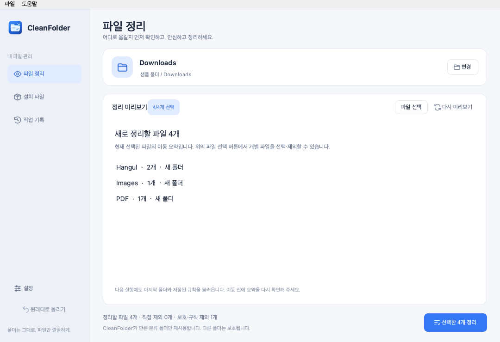
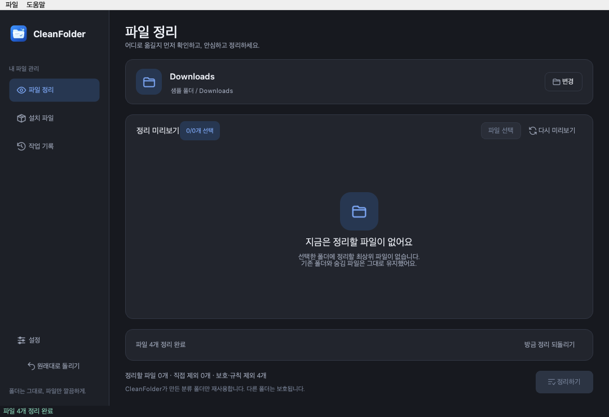

# CleanFolder v1.6.0 — 간편 화면과 반복 정리

**상태: 소스 구현과 로컬 설치본 빌드·검증 완료, GitHub 미배포. 공개 설치본은 v1.5.0입니다.** AI 기능이나 모델 의존성을 추가하지 않았습니다.

## 이번 버전의 목표

다운로드 폴더를 같은 기준으로 반복 정리하는 Mac 사용자의 설정·화면 이동을 줄입니다. 파일 처리 알고리즘의 속도 향상이나 AI 분류 기능이 아니라, 기존 Core·설정·History/Undo를 기본 흐름으로 연결하는 변경입니다.

| 1.5.0 기본 사용 | 1.6.0 새 설치 기본 사용 |
| --- | --- |
| 파일별 목록과 세부 분류 확인 | 실제 이동 폴더별 요약 확인, 필요할 때 상세 보기 |
| 기본 시작 방식은 빈 화면 | 마지막 사용 폴더를 열어 미리보기 표시 |
| 기본 정리는 새 분류 폴더 생성 | 기록·식별 정보로 검증된 앱 생성 폴더만 재사용 |
| 사이드바 복구 버튼과 확인 창 | 완료 화면에서 방금 정리한 작업을 직접 복구 |

기존 사용자에게는 위 새 기본값을 강제로 적용하지 않습니다.

## 처음 사용하기

프로젝트 폴더에서 `.venv/bin/python -m cleanfolder`로 실행합니다. 새 환경의 설치 방법은 [소스 실행 안내](../development.md)를 참고하세요.

1. 폴더를 선택합니다.
2. 간편 요약의 실제 이동 폴더·파일 수·재사용 여부를 확인합니다.
3. 제외할 파일이 있으면 **파일 선택**을 누르고 목록의 행이나 체크박스를 클릭합니다. Space 키도 사용할 수 있으며 간편 화면으로 돌아와도 선택은 유지됩니다.
4. **선택한 N개 정리**를 누릅니다.
5. 필요하면 완료 화면의 **방금 정리 되돌리기**를 누릅니다.

다음 실행에서는 마지막 폴더와 저장된 규칙으로 미리보기만 표시합니다. 파일 이동은 사용자가 버튼을 눌러야 실행됩니다. 이미 정리된 파일은 재귀적으로 다시 분류하지 않으며, 새 최상위 파일이 같은 규칙의 대상이 됩니다. 임시로 체크 해제한 파일은 앱 재실행 시 다시 선택되므로, 계속 남겨둘 파일은 영구 제외 규칙에 저장하세요.

## 이전 버전에서 전환하기

- 기존 분류·제외 규칙·사용자 폴더 이름·새 폴더/재사용·시작 폴더 선택을 유지합니다.
- 기존 설정은 상세 화면으로 표시합니다. 미리보기의 **간편 보기** 또는 설정의 **정리 미리보기 → 간편 요약**으로 전환할 수 있습니다.
- 간편 화면에서 **이 폴더로 계속 정리**를 선택하면 마지막 폴더로 시작하고 앱 생성 분류 폴더를 재사용합니다. 규칙은 그대로 유지하며 파일은 자동 이동하지 않습니다.
- 저장하지 않은 설정 초안이 있으면 반복 정리 바로가기를 비활성화해 초안이 사라지는 것을 방지합니다.
- 기존 사용자 폴더는 재사용하지 않습니다. 같은 이름이 있으면 충돌을 피한 새 폴더를 만들고, 앱이 만든 폴더만 다음 작업에서 확인 후 재사용합니다.
- 기본 분류 13개는 그대로 유지합니다. `문서/미디어/기타` 묶음 분류는 이번 버전에 넣지 않았습니다.

## 즉시 복구의 범위

완료 버튼은 원래 폴더와 해당 작업 ID에 묶입니다. 다른 GUI나 MCP에서 더 최근 작업을 만들었다면 해당 버튼은 그 작업을 대신 복구하지 않고 거부합니다. 폴더 변경·외부 복구·작업 오류 후 오래된 버튼은 제거합니다. 일부 파일의 이동만 성공한 경우에도 기록된 작업을 복구할 수 있습니다.

복구는 파일 위치를 되돌리며 내용의 이전 버전을 백업하지 않습니다. 이름 충돌은 새 이름으로 처리합니다. 설치 파일의 휴지통 이동·기존 사이드바 복구·MCP 도구 네 개는 유지합니다. MCP 미리보기의 경로·승인·만료 정책은 바꾸지 않았습니다.

## 이전 버전과 비교하기

### 자동 검증으로 확인한 동작

2026-10-20 로컬 macOS, Python 3.13.11, PySide6 6.12.0, MCP SDK 1.30.0에서 139개 테스트가 통과했습니다. 이전 116개에 23개를 추가했으며, 기존 GUI 회귀 테스트는 1.5.0의 명시적 기본 설정으로 유지해 새 기본값의 테스트와 구분했습니다.

- 간편/상세 전환 시 같은 계획·선택 유지
- 저장된 마지막 폴더의 재시작 미리보기와 사용자 정리 전 파일 미이동
- 반복 정리 시 앱 생성 폴더 재사용과 사용자 기존 폴더 보호
- 완료 화면의 복구에 추가 확인 창을 띄우지 않으며, 최신 작업 ID 변경 시 복구 거부
- 기존 설정 호환·설정 저장 실패·일부 파일 이동 실패 후 복구

### 사용자 비교 실험

다음 수치는 아직 측정하지 않았습니다. 실제 성능 개선율로 발표하려면 동일한 Mac·파일시스템·복사한 동일 파일 세트로 버전별 비교가 필요합니다.

| 항목 | 측정 방법 |
| --- | --- |
| 반복 정리 시간 | 앱 시작부터 두 번째 정리 완료까지 측정. 최초 설정 시간은 별도 기록 |
| 조작 횟수 | 폴더 선택·확인·화면 전환·실행 등 실제 입력 횟수 기록 |
| 복구 과정 | 정리 완료부터 원래 위치 복구까지의 시간·입력 수 기록 |
| 미리보기·파일 처리 속도 | 100/1,000/10,000개 동일 파일로 여러 번 측정하고 중앙값·파일 수 기록 |
| 정확성 | 파일 수·내용·제외 항목·기존 폴더·복구 결과 비교 |

기존 버전에서도 시작 폴더·폴더 재사용을 설정할 수 있었습니다. 기본값끼리의 비교와 같은 설정으로 맞춘 비교를 구분해야 합니다. 현재 처리 속도·CPU·메모리 개선율이나 사용자 작업 시간 단축률은 주장하지 않습니다.

## 로컬 설치본 검증

2026-10-20 Apple Silicon 환경에서 다음 파일을 `dist/macos/`에 생성했습니다. DMG 또는 앱 ZIP 중 하나만 사용하면 됩니다.

| 파일 | 용량 | 용도 |
| --- | --- | --- |
| `CleanFolder-1.6.0-macOS-AppleSilicon.dmg` | 27.9 MiB | 앱을 Applications로 복사하는 설치 이미지 |
| `CleanFolder-1.6.0-macOS-AppleSilicon.zip` | 25.4 MiB | 같은 앱의 대체 다운로드 |
| `SHA256SUMS.txt` | 체크섬 파일 | DMG·ZIP 무결성 확인 |

`.venv/bin/python -m scripts.verify_macos`로 체크섬, 번들 버전·리소스·서명 무결성, 개발 가상환경 없이 실행되는 내장 환경, `.hwp`·`.hwpx`와 사용자 지정 PDF 폴더의 미리보기, offscreen 화면 초기화, DMG의 읽기 전용 마운트·설치 구성을 확인했습니다. 미리보기 후 원본 파일 내용도 유지됩니다.

이 검증은 Apple 개발자 인증서 서명·공증이나 다른 Mac에서의 실제 실행을 대신하지 않습니다. GitHub 릴리즈는 아직 게시하지 않았습니다.

## 배포 전 남은 확인

- 실제 설치 앱에서 처음 사용·반복 실행·복구 확인
- 사용자 비교 실험과 다른 Mac의 실행 확인
- Apple 개발자 인증서 서명·공증, Windows·Intel 실사용 검증은 별도 작업

새 설치본을 직접 설치하기 전에는 기존 v1.5.0 앱이 바뀌지 않습니다. 로컬 빌드만으로 GitHub 릴리즈가 변경되거나 새 버전이 공개되지는 않습니다.

[README](../../README.md) · [변경 이력](../../CHANGELOG.md) · [구조](../architecture.md)
